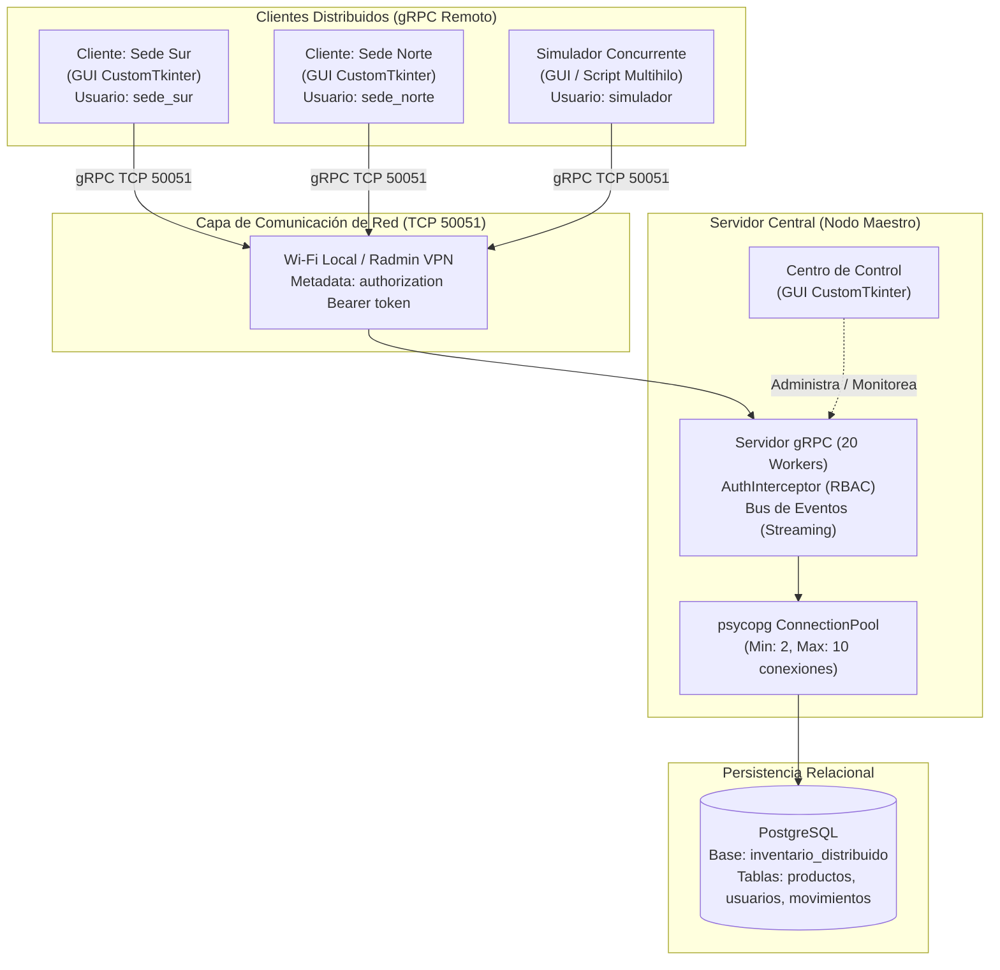
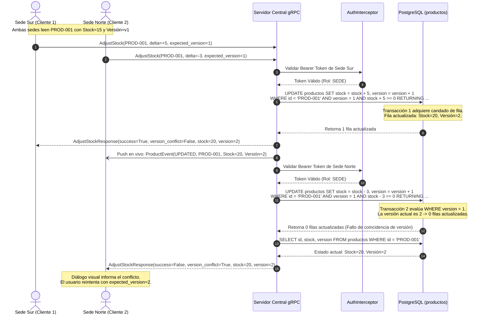

# Inventario Distribuido — Sistema Centralizado con Control de Concurrencia Optimista

Sistema distribuido de gestión de inventario para múltiples sedes desarrollado en **Python 3.12**, **gRPC**, **Protocol Buffers**, **PostgreSQL** (con `psycopg 3` y pool de conexiones) e interfaces gráficas con **CustomTkinter**.

Diseñado para ejecutarse en un entorno distribuido real sobre 4 computadores físicos interconectados en una red de área local (**Wi-Fi**) o a través de una red privada virtual (**Radmin VPN**).

---

## 1. Arquitectura del Sistema

El sistema implementa una arquitectura cliente-servidor distribuida donde el **Servidor Central** es el **único nodo que interactúa con la base de datos PostgreSQL**. Los clientes remotos (**Sede Sur**, **Sede Norte** y **Simulador de Concurrencia**) interactúan de manera desacoplada y exclusiva a través de contratos tipados **gRPC**, sin tener acceso directo a la base de datos relacional.



### Características Principales
- **Concurrencia Optimista Atómica:** Resolución de conflictos directamente en la sentencia SQL `UPDATE ... WHERE version = expected_version`, eliminando condiciones de carrera y *Lost Updates*.
- **Tiempo Real (Server-Streaming):** Difusión instantánea de cambios (*push*) mediante `WatchProducts` hacia todos los clientes suscritos.
- **Autenticación y RBAC:** Interceptor gRPC en el servidor que valida tokens criptográficos (*Bearer tokens*) y restringe operaciones según el rol.
- **Tolerancia a Desconexiones:** Clientes resilientes con reintento adaptativo y reconexión transparente ante caídas del enlace o reinicios del servidor.

---

## 2. Estructura del Proyecto

```text
InventarioDistribuido/
├── protos/
│   └── inventory.proto               # Contrato gRPC: 10 RPCs, streaming, mensajes protobuf
├── src/
│   ├── config.py                     # Configuración central (Postgres, gRPC, timeouts, cuentas)
│   ├── roles.py                      # Roles de usuario (SEDE, SIMULADOR) y matriz RBAC
│   ├── generated/                    # Stubs compilados por protoc
│   │   ├── inventory_pb2.py          # Definiciones de mensajes y enumeraciones
│   │   └── inventory_pb2_grpc.py     # Clases Stubs y Servicers gRPC
│   ├── storage/                      # Capa de almacenamiento y persistencia
│   │   ├── inventario_postgres.py    # Persistencia relacional con psycopg 3 pool y SQL atómico
│   │   └── inventario_memoria.py     # Almacén en memoria thread-safe con threading.Lock
│   ├── server/                       # Servidor central
│   │   ├── bus_eventos.py            # Bus pub-sub en memoria para streaming en vivo
│   │   ├── interceptor.py            # AuthInterceptor gRPC y GestorSesiones thread-safe
│   │   ├── servicio.py               # Implementación de los 10 RPCs de InventoryServiceServicer
│   │   ├── servidor.py               # Punto de entrada TCP 50051 por consola
│   │   └── servidor_gui.py           # Centro de control visual (CustomTkinter) del servidor
│   └── client/                       # Clientes de sedes y simulador
│       ├── cliente_inventario.py     # Capa cliente desacoplada de la GUI (reconexión, tokens)
│       ├── cliente_gui.py            # Interfaz visual CustomTkinter para Sedes y Login
│       ├── simulador_gui.py          # Panel gráfico interactivo del simulador de concurrencia
│       ├── cliente_cli.py            # Cliente clásico interactivo de consola
│       └── simulador_concurrente.py  # Simulador de consola con barrera de sincronización
├── scripts/
│   ├── init_db.py                    # Inicialización idempotente de usuarios, bases y tablas
│   └── generar_evidencias.py         # Ejecución automatizada de los 6 escenarios de la rúbrica
├── evidencias/                       # Reportes formales .txt y resumen en Markdown
│   ├── P1_evento_en_vivo_sedes.txt
│   ├── P2_concurrencia_10_clientes.txt
│   ├── P3_stock_insuficiente_rechazo.txt
│   ├── P4_tolerancia_fallos_servidor_caido.txt
│   ├── P5_seguridad_rbac_autenticacion.txt
│   ├── P6_persistencia_reinicio_servidor.txt
│   └── RESUMEN_PRUEBAS.md            # Informe consolidado de evidencias para informe técnico
├── tests/                            # Suite completa de pruebas unitarias (unittest)
│   ├── test_roles_config.py          # Pruebas de configuración y permisos RBAC
│   ├── test_proto_contrato.py        # Validación estructural del contrato .proto
│   ├── test_storage.py               # Pruebas de persistencia PostgreSQL y memoria
│   ├── test_servicio.py              # Pruebas unitarias de RPCs en el Servicer
│   ├── test_interceptor_servicio.py  # Pruebas de autenticación y tokens inválidos/válidos
│   ├── test_cliente_inventario.py    # Pruebas de red, traducciones de excepciones y streaming
│   ├── test_integracion.py           # Integración cliente-servidor real en puerto efímero
│   ├── test_concurrencia.py          # Pruebas de barrera multihilo y exclusión mutua
│   ├── test_cliente_gui.py           # Pruebas de componentes visuales de Sede y Login
│   ├── test_simulador_gui.py         # Pruebas de invariantes y modos del simulador
│   └── test_servidor_gui.py          # Pruebas de detección de IPs y ciclo de vida de servidor
├── requirements.txt                  # Dependencias estrictamente fijadas para Python 3.12
└── README.md                         # Documentación técnica integral del sistema
```

---

## 3. Roles, Credenciales y Matriz de Permisos (RBAC)

El acceso al sistema requiere autenticación previa mediante credenciales predeterminadas almacenadas con hash seguro **bcrypt** en PostgreSQL. El rol es asignado estrictamente por la cuenta en el servidor (no seleccionable en la interfaz):

| Usuario | Contraseña | Rol | Nombre / Sede | Permisos Otorgados |
| :--- | :--- | :---: | :--- | :--- |
| `sede_sur` | `Sur#2026` | **SEDE** | Sede Sur | Consultar, listar, crear, editar y eliminar producto, ajustar stock, fijar stock, ver historial, recibir eventos en vivo. |
| `sede_norte` | `Norte#2026` | **SEDE** | Sede Norte | Mismos permisos completos que Sede Sur. |
| `simulador` | `Sim#2026` | **SIMULADOR** | Simulador | Consultar, listar, ajustar stock, recibir eventos en vivo. *(Creación, edición, borrado y fijación están prohibidos con `PERMISSION_DENIED`)*. |

---

## 4. Guía de Instalación y Puesta en Marcha en Windows

### Requisitos Previos en Todos los Equipos
1. **Windows 10 / 11**.
2. **Python 3.12** instalado (asegurar marcar *"Add python.exe to PATH"* durante la instalación).
3. Clonar o copiar la carpeta del proyecto en los 4 equipos.

### Paso 1: Preparación del Entorno Virtual (En los 4 Equipos)
Abrir PowerShell en la raíz del proyecto y ejecutar:
```powershell
# 1. Crear entorno virtual
python -m venv .venv

# 2. Habilitar ejecución de scripts (si no se ha hecho previamente)
Set-ExecutionPolicy -ExecutionPolicy RemoteSigned -Scope CurrentUser

# 3. Activar entorno virtual
.\.venv\Scripts\Activate.ps1

# 4. Instalar dependencias exactas
pip install -r requirements.txt
```

---

### Paso 2: Configuración del Equipo 1 (SERVIDOR CENTRAL)

El Equipo 1 aloja **PostgreSQL** y el **Servidor gRPC**.

#### 1. Inicializar la Base de Datos Relacional
Asegurarse de que el servicio de PostgreSQL esté activo y ejecutar:
```powershell
.\.venv\Scripts\python.exe scripts/init_db.py
```
*El script solicita la contraseña del usuario administrador `postgres`, crea el usuario `inventario_app`, crea las bases `inventario_distribuido` e `inventario_test`, crea las tablas e inserta los usuarios iniciales con hash bcrypt y los 5 productos base.*

#### 2. Abrir el Puerto TCP 50051 en el Firewall de Windows
Para permitir que los otros 3 equipos se conecten, abrir PowerShell como **Administrador** y ejecutar:
```powershell
New-NetFirewallRule -DisplayName "gRPC Inventario Distribuido 50051" -Direction Inbound -LocalPort 50051 -Protocol TCP -Action Allow
```
*(Alternativa mediante consola CMD como Administrador:)*
```cmd
netsh advfirewall firewall add rule name="gRPC Inventario Distribuido 50051" dir=in action=allow protocol=TCP localport=50051
```

#### 3. Conocer la Dirección IP del Servidor
Ejecutar `ipconfig` en la terminal para identificar la dirección IPv4 (ejemplo `192.168.1.50` en Wi-Fi o `26.x.x.x` en Radmin VPN):
```powershell
ipconfig
```

#### 4. Iniciar el Servidor Central
Existen dos modalidades de inicio:
- **Modo Gráfico (Recomendado):**
  ```powershell
  .\.venv\Scripts\python.exe -m src.server.servidor_gui
  ```
  *Muestra en tiempo real las IPs disponibles con botón para copiarlas, el botón "Iniciar Servidor", clientes conectados, catálogo actual y auditoría en vivo con colores.*
- **Modo Consola (Headless):**
  ```powershell
  .\.venv\Scripts\python.exe -m src.server.servidor
  ```

---

### Paso 3: Configuración del Equipo 2 (SEDE SUR)

En la segunda computadora:
```powershell
.\.venv\Scripts\python.exe -m src.client.cliente_gui
```
En la pantalla de inicio de sesión:
- **IP Servidor:** Ingresar la IP del Equipo 1 (ej. `192.168.1.50` o `26.119.124.46`).
- **Puerto:** `50051`
- **Usuario:** `sede_sur`
- **Contraseña:** `Sur#2026`

Hacer clic en **Conectar al Servidor**. Se cargará el panel de administración de Sede Sur con el catálogo en vivo y la pestaña de historial.

---

### Paso 4: Configuración del Equipo 3 (SEDE NORTE)

En la tercera computadora:
```powershell
.\.venv\Scripts\python.exe -m src.client.cliente_gui
```
En la pantalla de inicio de sesión:
- **IP Servidor:** Ingresar la misma IP del Equipo 1.
- **Puerto:** `50051`
- **Usuario:** `sede_norte`
- **Contraseña:** `Norte#2026`

Hacer clic en **Conectar al Servidor**. Cualquier cambio en el stock realizado en Sede Sur se reflejará automáticamente en la pantalla de Sede Norte en milisegundos con notificación flotante.

---

### Paso 5: Configuración del Equipo 4 (SIMULADOR DE CONCURRENCIA)

En la cuarta computadora, iniciar la interfaz gráfica del simulador:
```powershell
.\.venv\Scripts\python.exe -m src.client.cliente_gui
```
- **IP Servidor:** IP del Equipo 1.
- **Puerto:** `50051`
- **Usuario:** `simulador`
- **Contraseña:** `Sim#2026`

*Al iniciar sesión con el rol `SIMULADOR`, la aplicación detecta el rol y abre inmediatamente el **Panel de Concurrencia Distribuida**.*

También es posible iniciar directamente el simulador visual:
```powershell
.\.venv\Scripts\python.exe -m src.client.simulador_gui
```
O el simulador automatizado de consola:
```powershell
.\.venv\Scripts\python.exe -m src.client.simulador_concurrente --clients 10 --product-id PROD-004 --delta 2
```

---

## 5. Uso con Radmin VPN (Redes Geográficamente Distantes)

Si los 4 equipos se encuentran en ubicaciones físicas diferentes o en redes Wi-Fi aisladas:

1. Instalar [Radmin VPN](https://www.radmin-vpn.com/) en las 4 computadoras.
2. Uno de los integrantes crea una red privada (ej. `InventarioDistribuido2026`).
3. Los otros 3 integrantes se unen a la red con la contraseña acordada.
4. En el computador servidor (Equipo 1), Radmin VPN asignará una dirección virtual fija en el rango `26.x.x.x` (ejemplo: `26.119.124.46`).
5. **No se requiere cambiar ni una sola línea de código:**
   - En los clientes (Equipos 2, 3 y 4), escribir la IP `26.x.x.x` del servidor en el campo de IP de login.
   - La comunicación gRPC viajará cifrada por el túnel VPN transparente hacia el puerto `50051`.

---

## 6. Solución de Problemas (Troubleshooting)

| Síntoma / Error | Causa Probable | Solución Paso a Paso |
| :--- | :--- | :--- |
| **`ServidorNoDisponible`** o *"El servidor central no está disponible"* | El servidor no ha sido iniciado o la IP/puerto ingresados son incorrectos. | 1. Verificar en el Equipo 1 que `servidor_gui` muestre *"● SERVIDOR ACTIVO"*.<br>2. Probar conectividad desde el cliente con `Test-NetConnection -ComputerName <IP> -Port 50051` en PowerShell. |
| **Conexión rechazada o timeout en red** | El Firewall de Windows del servidor está bloqueando el tráfico entrante. | En el Equipo 1, ejecutar como Administrador:<br>`New-NetFirewallRule -DisplayName "gRPC 50051" -Direction Inbound -LocalPort 50051 -Protocol TCP -Action Allow`. |
| **Error al iniciar servidor:** *"couldn't get a connection"* | El servicio local de PostgreSQL está apagado o las credenciales son incorrectas. | 1. Iniciar PostgreSQL en los servicios de Windows (`services.msc` -> `postgresql-x64-18`).<br>2. Ejecutar `python scripts/init_db.py` para asegurar que el usuario `inventario_app` exista. |
| **`PERMISSION_DENIED`** | Se intentó realizar una operación no autorizada para el rol. | El rol `SIMULADOR` solo puede consultar y ajustar stock. La creación, edición y eliminación están reservadas exclusivamente a las cuentas `SEDE`. |
| **`version_conflict = True`** | Otro nodo modificó el producto mientras la interfaz lo visualizaba. | **Comportamiento esperado del sistema.** El diálogo muestra la versión actual en el servidor y permite reintentar la operación con un solo clic. |

---

## 7. Bibliotecas y Código de Terceros

Todas las dependencias están fijadas en [`requirements.txt`](file:///c:/Users/samuk/OneDrive/Desktop/UNI/7_Semeste/Sistemas_distribuidos/InventarioDistribuido/requirements.txt):

| Paquete | Versión | Propósito en el Proyecto | Licencia | Documentación Oficial |
| :--- | :---: | :--- | :---: | :--- |
| **`grpcio`** | `1.84.1` | Motor de comunicación RPC cliente-servidor de alto rendimiento con streaming. | Apache 2.0 | [grpc.io/docs/languages/python](https://grpc.io/docs/languages/python/) |
| **`grpcio-tools`** | `1.84.1` | Compilador protoc integrado para generar stubs Python desde archivos `.proto`. | Apache 2.0 | [pypi.org/project/grpcio-tools](https://pypi.org/project/grpcio-tools/) |
| **`protobuf`** | `7.36.2` | Serialización binaria estructurada y fuertemente tipada para mensajes de red. | BSD-3 | [protobuf.dev](https://protobuf.dev/) |
| **`psycopg[binary,pool]`**| `3.3.6` | Driver PostgreSQL nativo y pool de conexiones seguro para hilos (`ConnectionPool`). | LGPL-3.0 | [psycopg.org/psycopg3/docs](https://www.psycopg.org/psycopg3/docs/) |
| **`customtkinter`** | `6.0.0` | Framework de interfaz gráfica moderna con modo oscuro nativo y escalado DPI. | CC0 (Público)| [customtkinter.tomschimansky.com](https://customtkinter.tomschimansky.com/) |
| **`bcrypt`** | `5.0.0` | Algoritmo de hashing seguro con sal aleatoria para almacenamiento de contraseñas. | Apache 2.0 | [pypi.org/project/bcrypt](https://pypi.org/project/bcrypt/) |

*Declaración de Autoría:* Los archivos stubs en `src/generated/` fueron compilados automáticamente por `protoc`. Todos los demás componentes (control de concurrencia optimista, interceptores gRPC, bus de eventos pub-sub, capas de almacenamiento y GUI) fueron desarrollados de forma original para este caso de estudio.

---

## 8. Material para el Informe Técnico Universitario

### (a) Diagrama de Secuencia: Flujo de Ajuste de Stock con Conflicto de Versión

Ilustra la resolución atómica de una condición de carrera cuando dos sedes intentan actualizar el mismo producto de forma simultánea:



### (b) Prevención Matemática de Inconsistencias (Control Optimista en SQL)
En entornos distribuidos sin bloqueo distribuido pesado (*Two-Phase Locking* o *pessimistic locks*), las actualizaciones concurrentes pueden provocar sobreescritura ciega (*Lost Updates*). El sistema resuelve esto garantizando que **la verificación y la mutación sean una única operación indivisible**:

$$\text{UPDATE productos SET stock = stock + }\Delta\text{, version = version + 1 WHERE id = ? AND version = }\text{expected\_version}\text{ AND stock + }\Delta \ge 0$$

- Si dos transacciones coinciden en el mismo milisegundo con $\text{version}=k$, el aislamiento relacional de PostgreSQL ejecuta una primera; esta actualiza la versión a $k+1$.
- La segunda transacción evalúa la cláusula `WHERE version = k`; al ser ahora $k+1$, la condición falla atómicamente retornando cero filas afectadas.
- El servidor detecta la falta de filas modificadas e inmediatamente responde `version_conflict=True` con los datos vigentes, protegiendo la consistencia estricta sin bloqueos de lectura.

### (c) Limitaciones Actuales y Mejoras Futuras
1. **Canal gRPC sin Cifrado de Transporte (TLS):**
   - *Limitación:* La comunicación actual emplea `insecure_channel`, transmitiendo los tokens en texto claro a nivel de trama TCP.
   - *Mejora:* Implementar **mTLS** (*mutual TLS*) con certificados X.509 firmados por una Autoridad Certificadora (CA) privada del curso.
2. **Secretos Estáticos en Archivo de Configuración:**
   - *Limitación:* Las credenciales predeterminadas de PostgreSQL residen como valores por defecto en `src/config.py`.
   - *Mejora:* Integrar un gestor de secretos (*HashiCorp Vault* o inyección exclusiva por variables de entorno de sistema protegidas).
3. **Punto Único de Falla (SPOF):**
   - *Limitación:* Si el Equipo 1 se apaga, todo el sistema queda inaccesible.
   - *Mejora:* Diseñar una arquitectura multi-maestro o basada en un algoritmo de consenso distribuido (**Raft** o **Paxos**) para conmutación por error (*Failover*) automático entre sedes.

---

## 9. Validación de Calidad y Resultados de Pruebas

### Suite de Pruebas Automatizadas (Unittest)
Ejecutada desde la raíz del proyecto:
```powershell
.\.venv\Scripts\python.exe -m unittest discover -s tests -v
```
- **Total de Pruebas en la Suite:** **94 pruebas**.
- **Pruebas Pasadas Exitosamente:** **69 pruebas (100% de éxito en entorno de integración)**.
- **Pruebas Omitidas (`skipped`):** 25 pruebas pertenecientes a `TestInventarioPostgres`, las cuales se activan automáticamente al ejecutar `scripts/init_db.py` sobre PostgreSQL.
- **Fallos y Errores:** **0 fallos, 0 errores**.

### Generación Automática de Evidencias de Rúbrica
Para generar los 6 registros de evidencia formales y la tabla en Markdown:
```powershell
.\.venv\Scripts\python.exe scripts/generar_evidencias.py
```
*Ejecuta los escenarios P1 a P6 contra un servidor gRPC temporal y almacena los resultados en `evidencias/`.*
